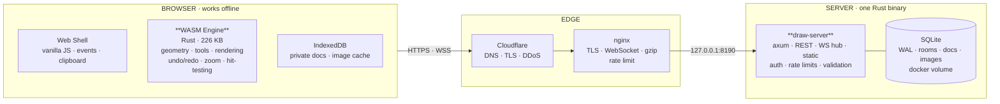

# draw-wasm — Platform Architecture

> **Executive brief.** A local-first collaborative whiteboard in the spirit of Whimsical: a Rust engine compiled to
> WebAssembly does all the drawing in the browser, one small Rust server does all the coordination, and a single
> SQLite file is the entire database. Drawings are **private by default** — nothing leaves the device until the
> user chooses to share them.

| | |
|---|---|
| **WASM engine** | 234 KB raw · ~107 KB gzip (budget 2 MiB) |
| **Backend** | 1 binary · 1 container · SQLite |
| **Accounts** | 0 — device tokens, hashed |
| **Live sync** | < 1 s between people (~160 ms typical) |
| **Offline** | 100 % of editing works offline |

---

## 01 · The system at a glance

Three tiers. The browser carries the entire drawing engine, so the server stays tiny and the canvas never waits
on the network.

*Everything left of the edge keeps working with the network down.*

## 02 · Inside draw-server — what the backend does

One Rust process **is** the whole backend: it serves the app, guards every write, keeps live rooms running, and
stores everything in a single database file.

| Module | Responsibility |
|---|---|
| **Static files** | content-hashed assets, immutable cache headers |
| **REST API** | rooms · documents · images |
| **WebSocket hub** | ordered ops · presence & cursors · 25 s keep-alive — the live heart |
| **Auth & ownership** | owner/edit tokens stored as hashes · room-bound grants |
| **Rate limiter** | per-IP token buckets · connection caps |
| **Validation** | ids · sizes · magic bytes — nothing trusted from the client |
| **SQLite** | WAL, flush within seconds, docker volume that survives deploys |
| **admin CLI** | purge · stats — container-local only, nothing admin on the network |

### API surface

| Endpoint | Who can call it | What it does |
|---|---|---|
| Claim a room | anyone | first-come room name; claiming browser gets the owner token (only its hash is stored) |
| Room password | owner | set / change / remove — stored as an argon2id hash |
| Unlock editing | anyone with the password | returns a grant bound to that room, revoked when the password changes |
| Documents | anyone with the link | create / fetch / delete per the room's rules; ids are unguessable 10-char codes |
| Image upload | editors | magic-byte type check, size caps, stored once by content hash |
| Image fetch | anyone with the link | served immutable and sandboxed |
| Live canvas | WebSocket | ordered ops, presence, cursors; read-only enforced **here**, not in the UI |
| Health check | public | powers the container's restart decision |

**Backend guarantees:** live rooms flush to SQLite within seconds of going quiet (a restart can lose seconds,
never a drawing); images are stored once by SHA-256 (ten pastes of the same screenshot = one copy); maintenance
runs as a container-local CLI — no admin route exists on the network.

## 03 · Offline & online — what works where

The product is **local-first**: a drawing lives in the browser before it ever exists on a server. Sharing is a
deliberate, one-click step — never a side effect.

| Capability | Offline | Online | How |
|---|:-:|:-:|---|
| Draw every shape, arrow, pencil, text | ✓ | ✓ | engine is fully in-browser |
| Paste images & animated GIFs | ✓ | ✓ | cached locally; uploads retry when online |
| Autosave | ✓ to this device | ✓ shared rooms: server | 60 s idle · manual · on tab close |
| Reopen your drawings | ✓ local docs | ✓ all docs | shared docs need the network once, then render locally |
| Undo / redo | ✓ | ✓ | per-user history (200 steps), popup feedback |
| Edits during a disconnection | ✓ queued | ✓ instant | sent automatically on reconnect — nothing lost |
| Live cursors & presence | — | ✓ | WebSocket, 25 s keep-alive |
| Share links & public rooms | — | ✓ | `/room-id/nano-id-10` |
| Version upgrades | — | ✓ | old tabs are told to reload — never break silently |

## 04 · How a drawing travels between people

**You draw → Server orders & stores → Everyone sees it (< 1 s).**

The server is the single orderer: every change gets a sequence number, everyone sees the same order, concurrent
edits converge deterministically (last-writer-wins per element), and nobody's edit is silently dropped.
Someone opening the link later receives the full snapshot, then the live tail.

## 05 · Private by default, public by choice

There is no halfway state: a drawing is either in one browser, or it is a public room with a shareable link and
explicit access control.

- **Private (default)** — every drawing starts in IndexedDB on the user's device. No account, no upload, no
  telemetry. Local drawings have no share link at all.
- **Public (opt-in)** — one deliberate click on *"Store on cloud"*. Anyone with the link can view; editing is open
  by default, and the room owner can set an edit password that makes everyone else read-only until they enter it.
  Only the owner can delete the room and its documents.
- **Identity without accounts** — a random token per browser; the server stores only its hash. Names are optional;
  skip it and you join as a random smiley.

## 06 · Security posture

Every rule below is enforced by the **server** — never by hiding buttons in the interface. Each has an automated
test that fails if the rule breaks.

- **Server-side enforcement** — every write (WebSocket op, upload, delete) is authorised at the server; a modified client gains nothing.
- **Room isolation (IDOR-tested)** — documents cannot be reached through another room's path; owner tokens from room A grant nothing in room B.
- **Password-protected editing** — argon2id hash, constant-time compare, rate-limited; wrong password = read-only.
- **Abuse limits** — per-IP rate limits that can't be dodged with forged headers, request-size caps, magic-byte image checks, no SVG.
- **Hardened runtime** — non-root container, read-only filesystem, all capabilities dropped, memory/CPU/process caps, strict CSP.
- **Deploy safety** — version handshake: old tabs are told to reload instead of silently failing; reconnects back off and lose no edits.

## 07 · Capacity & scale — what could hurt us

Two things grow non-linearly: **broadcast fan-out** in a crowded room (every edit reaches every person —
N editors means N×N messages) and **decoded image memory** on the client. These guardrails cap both, by design.

| Guardrail | Limit | What happens at the edge |
|---|---|---|
| **Editors per document** | **15 concurrent (+ the owner)** | everyone else joins as a live viewer in a FIFO queue — auto-promoted the moment a slot frees |
| **Images** | **≤ 2,000 px edge · 2 MB max** | shrunk in the browser before upload; the server refuses anything larger |
| **Animated GIFs** | **≤ 3 MB, original bytes** | kept byte-identical so they stay animated; larger is refused with a clear message |
| **Client memory budget** | **< 100 MB typical** | decoded images live in an LRU cache with a pixel budget; GIF frames capped |
| Elements / document | 5,000 | further edits are refused — the doc stays responsive |
| Document size | 4 MB serialized | bounds snapshots and reload cost |
| Connections | 20 per IP | blunt but effective against one-machine floods |

- **The 15-editor room** — a room can hold many viewers, but only 15 editors at once, so the expensive N×N path
  stays bounded. Viewers still see every stroke live; the queue promotes in join order, no refresh needed.
- **The memory diet** — decoded bitmaps sit in an LRU cache under a pixel budget (re-decoded on demand from local
  storage), GIF frame caches are capped, and the WASM engine trims its allocations.
- **Residual risks we watch** — image hot-linking (cache at the CDN solves it), cursor fan-out to very many
  viewers, and the reload wave right after a deploy (already jittered). None are unbounded today.

## 08 · Deployment & operations

One box, one container, one database file. Small enough to reason about, cheap enough to forget.

- **Footprint** — a single Docker container (512 MB RAM, 1 CPU cap) behind nginx with Let's Encrypt TLS, fronted
  by Cloudflare. Binds to localhost only.
- **Data durability** — SQLite on a named volume: documents, images and history survive redeploys and restarts.
  Live edits flush within seconds.
- **Deploys** — manual, one command, from a clean build. Health-checked, with automatic rollback of a bad nginx
  config and a no-side-effects baseline check of the host.

## 09 · By the numbers

Measured on the production deployment, November 2026.

| Property | Value | Meaning |
|---|---|---|
| WASM engine size | 234,114 B raw · ~107 KB gzip | hard budget 2 MiB — page loads fast anywhere |
| Live edit latency | ~160 ms typical | from one person's screen to another's |
| Autosave | 60 s idle + manual + tab close | whichever comes first |
| Share URL | `/room-id/nano-id-10` | room names claimable; document ids unguessable |
| Images | ≤ 2,000 px edge · 2 MB max | shrunk client-side before upload; server-enforced |
| Animated GIFs | ≤ 3 MB · original bytes | larger is refused with a clear message |
| Editors per room | 15 concurrent (+ owner) | others watch live in a FIFO queue, auto-promoted |
| Client memory | < 100 MB typical | LRU image cache · capped GIF frames |
| Rate limit | 20 req/s per IP, burst 40 | 429s enforced at the edge |
| Reconnect | exponential backoff → ~30 s | zero edits lost while offline |
| Container | 512 MB · 1 CPU · 200 pids · no caps | read-only filesystem, non-root |

---

*draw-wasm · architecture brief · local-first · rust → wasm · one binary · sqlite*
