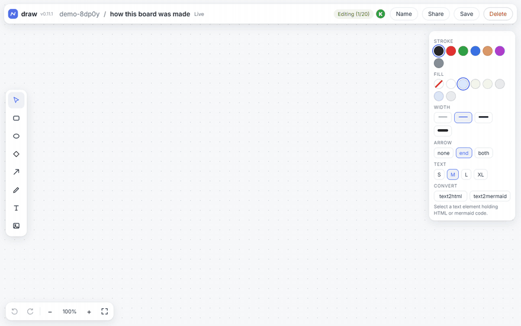
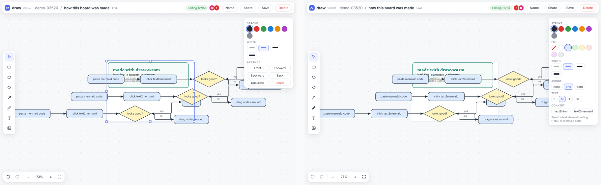
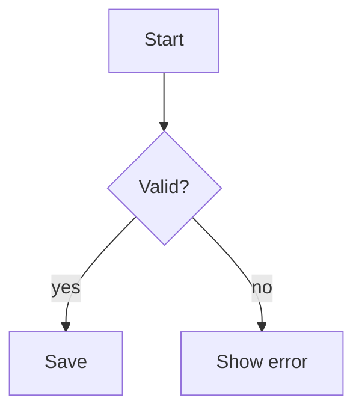

# draw-wasm

<div align="center">

[](web/version.js)
[](#size-budget)
[](#security-model)
[](LICENSE)

**A Whimsical-style whiteboard that runs on a 137 KB Rust engine.**
Local-first, live-collaborative, one small server binary, one SQLite file.



*paste an animated GIF (the cat survives), paste mermaid, zoom out, `text2mermaid` -- an org chart blooms next to the text; then paste HTML and `text2html` renders it as a safe card. Every frame above is the real app, not a mockup. Cat by @faaannnyyy4.*

</div>

---

## Features

- **Tools** -- select, rectangle, ellipse, diamond, arrow (binds to shapes and follows them), smoothed pencil, text (free-standing or inside shapes via double-click), images (paste or drop).
- **Whimsical-style arrow routing** -- orthogonal segments, rounded corners, anchors on the facing side, and arrows that dodge the nodes in between. Complex graphs stay tidy. Select an arrow and drag a segment handle to adjust the elbow (the route is stored on the element and syncs); double-click a handle or press `reset route` to go back to automatic routing.
- **`text2mermaid`** -- paste mermaid code, select it, one click: real rectangles, diamonds, circles, stadiums, labelled subgraph containers and routed arrows, parsed and laid out by the WASM engine itself (no JS mermaid library). The flow is created to the right of the text, which stays editable; one undo step removes only the new objects.
- **`text2html`** -- paste single-file HTML, select it, one click: it renders as an object in a sandboxed `<iframe>` where **JavaScript never runs**.
- **Local by default** -- documents live in IndexedDB on your device, private, no share link. Autosave after 60 s idle, explicit Save, save on tab hide.
- **Store on cloud** -- one deliberate click. Cloud documents are public: you pick a room ID (first come, first served), the share URL is `<roomID>/<NanoID>`.
- **Live collaboration** -- anyone with the URL edits together: presence cursors, required display names, owner marked. Last-writer-wins per element, server sequence numbers, snapshot on join and reconnect. At most 20 concurrent editors per document; everyone else watches live in a FIFO queue and is promoted the moment a slot frees.
- **Multi-select, move, resize, delete, duplicate, undo/redo, z-order, colour/stroke presets, arrowheads.** Zoom 10%..400%, pan, zoom to fit. Touch friendly. Names are optional for viewing: joiners without a name get a random face emoji. Animated GIFs keep their animation (original bytes, <= 3 MiB).
- The app version sits in the topbar next to the logo; error toasts quote it.



## Layout

| dir | what |
|---|---|
| `proto/` | shared wire types (used by engine and server so the format cannot drift) |
| `engine/` | WASM engine -- scene, hit-testing, arrow binding & routing, mermaid parsing & layout, undo/redo, Canvas2D rendering |
| `server/` | axum + rusqlite (bundled) + tokio; static files, REST API, WebSocket |
| `web/` | plain JS/HTML/CSS shell, no framework, no external requests at runtime |

## Where your data lives

- **Offline / private documents** are written entirely in the browser (IndexedDB). No server is involved: no upload, no account, no network write.
- **Online / cloud documents** use the server: SQLite for storage and a WebSocket for live collaboration.

The live instance runs at https://coret.app (share links look like `https://coret.app/<roomID>/<NanoID>`).

Architecture brief (HTML and Markdown): [`ARCH.html`](ARCH.html) / [`ARCH.md`](ARCH.md).

## Build

Requirements: Rust (stable) with `wasm32-unknown-unknown`, `wasm-bindgen-cli` (same version as the `wasm-bindgen` crate), `wasm-opt` (binaryen) optional but recommended.

    bash scripts/build-web.sh          # builds dist/ ; fails if engine_bg.wasm > 2 MiB
    cargo build --profile server -p draw-server
    DRAW_ADDR=127.0.0.1:8080 DRAW_DB=./draw.db DRAW_STATIC=dist target/server/draw-server

## Docker

    docker compose up -d --build       # listens on 127.0.0.1:8190
    # put a reverse proxy in front: see deploy/nginx.conf.template (replace @@HOST@@ with example.com)

The container runs as a non-root user with a read-only root file system, all capabilities dropped, memory/CPU/PID limits, and a named volume `draw_data` for the database.

Admin tasks run locally inside the container (there is no network admin endpoint):

    docker exec draw-app /app/draw-server admin stats
    docker exec draw-app /app/draw-server admin purge-prefix zz-test-

## Configuration

| Variable | Default | Meaning |
|---|---|---|
| `DRAW_ADDR` | `0.0.0.0:8080` | listen address |
| `DRAW_DB` | `/data/draw.db` | SQLite file |
| `DRAW_STATIC` | `/app/static` | built web bundle |
| `PUBLIC_BASE_URL` | (from request) | base URL used in share links, e.g. `https://example.com` |
| `DRAW_MAX_IMAGE_BYTES` | 2 MiB | per image (not GIF); the client re-encodes to fit |
| `DRAW_MAX_GIF_BYTES` | 3 MiB | per animated GIF, stored byte for byte; larger is refused |
| `DRAW_MAX_EDITORS` | 20 | concurrent editors per document (the owner does not count); the rest view in a FIFO queue |
| `DRAW_EDITOR_IDLE_SECS` | 600 | an editor idle this long yields the slot when somebody is waiting |
| `DRAW_MAX_DOC_IMAGE_BYTES` | 24 MiB | images per document |
| `DRAW_MAX_DOC_IMAGES` | 40 | images per document |
| `DRAW_MAX_ELEMENTS` | 5000 | elements per document |
| `DRAW_MAX_DOC_BYTES` | 4 MiB | serialized document |
| `DRAW_MAX_WS_MSG` | 2 MiB | WebSocket frame (fits a 400 KB HTML object) |
| `DRAW_MAX_CONNS_PER_IP` | 30 | concurrent sockets per client (raised from 20 so the 20-editor cap can be tested from one IP) |
| `DRAW_MAX_DOCS_PER_ROOM` | 100 | documents per room |
| `DRAW_MAX_ROOMS` | 5000 | rooms |

Deployment scripts read environment-specific values from the environment or an untracked `.deploy.env` (see `.deploy.env.example`).

## Security model

- Cloud documents and rooms are public by design: the URL is the capability to view and edit.
- Claiming a room gives the browser a random owner token (kept in IndexedDB); the server stores only its SHA-256.
- **Edit password (optional)**: by default everyone with the link can view, edit and delete. The owner can set a room password; then everyone without it is read-only (view, pan, zoom, cursors) and only the owner and holders of a server-issued edit grant may write. The password is stored as an argon2id hash; a successful unlock returns a random grant bound to that room (only its SHA-256 is stored, revoked whenever the password changes). Enforcement is server-side on the WebSocket, image upload, document create/delete and room changes. Unlock attempts are rate limited per client and per room. Changing or removing the password, and deleting the room, need the owner token.
- Rights are always computed on the server from stored state; flags a client sends about itself (owner, edit) are ignored. Participant ids are assigned by the server.
- IP addresses are never stored. A salted hash (salt regenerated at every start, memory only) is used solely for rate limiting.
- Every input is validated (ids, numbers, colours, sizes). Images are validated by magic bytes, served with the sniffed type, `nosniff` and a sandbox CSP. SVG is not accepted. Pasted HTML renders in an `<iframe sandbox>` with no `allow-scripts` and no `allow-same-origin`, so embedded JavaScript can never run.
- SQL is always parameterised. Output is escaped (DOM text nodes only). CSP forbids external hosts and inline script.
- Limits: message size, messages per second, connections per client, elements/bytes per document, images per document, request rates.

## Use it with AI -- no MCP needed

The app version is shown next to the logo (`window.__draw.version`); quote it when reporting a bug. An AI can drive the board with plain text:

1. Ask for mermaid code, paste it onto the board (it becomes a text element), select it and press **text2mermaid**. Real rectangles, diamonds, circles and routed arrows are created (parsed and laid out in the WASM engine; one undo step). Markdown fences, a BOM and trailing whitespace are tolerated. Subgraphs (`subgraph id [Label]` ... `end`, nested, with their own `direction`) become labelled containers; edges to a subgraph id connect the containers. The text element is never replaced: the flow appears to its right (convert again after editing the text for another copy). On a syntax error the line is named and nothing is created.



2. Ask for a single-file HTML page, paste it, select it and press **text2html**. It renders in an `<iframe sandbox>` with no `allow-scripts` and no `allow-same-origin`, so scripts never run (limit 400 KB). The text stays where it is and the rendered object appears to its right.

```html
<!DOCTYPE html><html><body><h1>Hello</h1><p>Rendered, never executed.</p></body></html>
```

## Size budget

`engine_bg.wasm` must stay at or below 2 MiB (2,097,152 bytes); `scripts/build-web.sh` fails otherwise. Release profile: `opt-level="z"`, LTO, one codegen unit, `panic="abort"`, strip, then `wasm-opt -Oz`. The server is served gzip-compressed by the reverse proxy.

## Tests

`BASE=http://127.0.0.1:8080 node tests/e2e.js` (Playwright with Chrome) drives the UI end to end. `cargo test -p draw-proto` runs unit tests. Against a deployed instance: `tests/multiuser.js` (every feature as owner and joiners), `tests/round7.js` (names, undo popup, labels, zoom, GIF, password), `tests/round10.js` (version, HTML objects, text2mermaid, whimsical routing), `tests/security.js` (authorisation / IDOR), `tests/abuse.js`, `tests/collab.js`, `tests/round5.js`. Test rooms start with `zz-test-` and are removed with `draw-server admin purge-prefix zz-test-`.

## License

MIT, see `LICENSE`.
